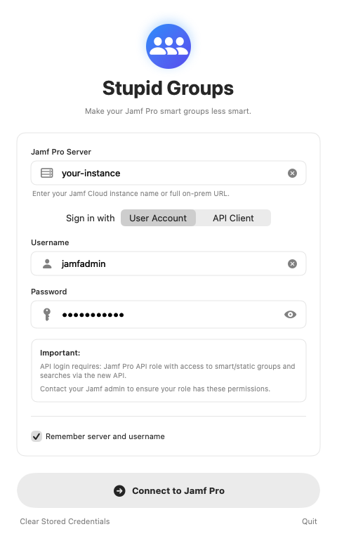
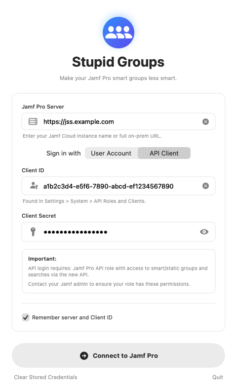
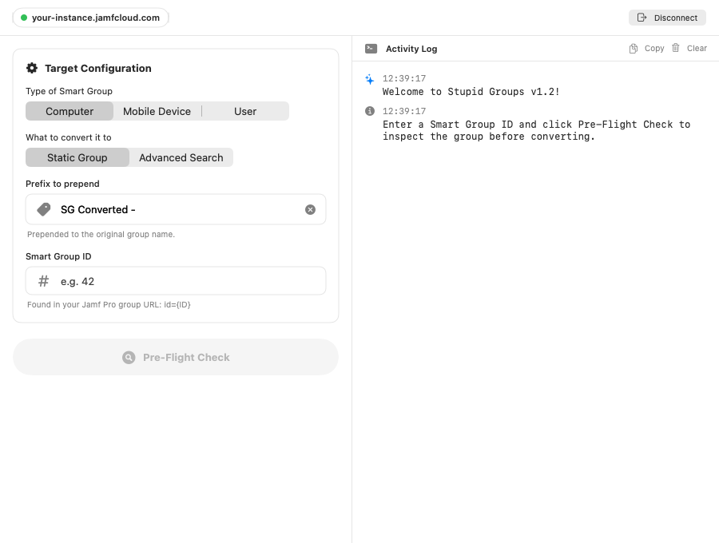

# Stupid Groups 2

**Make your Jamf Pro smart groups less smart.**

Stupid Groups converts Jamf Pro **Smart Groups** into either **Static Groups** or **Advanced Searches**. It covers computers, mobile devices, and users.

This is an updated fork of [mike-levenick/stupid-groups](https://github.com/mike-levenick/stupid-groups), the original learning project by Mike Levenick. Updates are by Russell Collis.

| | |
|---|---|
| **Version** | 2 |
| **Tested with** | Jamf Pro 11.29 |
| **Requires** | macOS 26 or later |
| **Signing** | The project is unsigned. Build it yourself in Xcode, or allow it in **System Settings › Privacy & Security** the first time it opens. |

---

## Why it exists

Smart Groups are a powerful tool in Jamf Pro. They're designed for active scoping to users or devices whose membership changes often. But many Jamf Pro servers also have Smart Groups that don't need to recalculate all the time:

- **Compliance reports** with nothing scoped to them. These can be calculated when someone views them, so an **Advanced Search** is a better fit.
- **Groups with fixed membership**, such as iPad carts. These rarely (if ever) change, so a **Static Group** is a better fit.

A large number of unnecessary Smart Groups can noticeably slow down a Jamf Pro server, and cleaning them up by hand is tedious. Stupid Groups automates the conversion.

---

## What's changed from the original

The original app (v1.1, 2019) stopped working once Jamf Pro 11.5 removed Basic authentication from the Classic API. This fork fixes that and adds several features.

### Authentication
- **Bearer tokens (Jamf Pro 11.5+):** your credentials are exchanged for a Bearer token at `/api/v1/auth/token`. Every later Classic API call uses that token instead of Basic auth.
- **New: API Client sign-in.** Besides a user account, you can sign in with a Jamf Pro **API Client** (Client ID and Client Secret) through `/api/oauth/token`.
- **Automatic token refresh:** tokens are renewed shortly before they expire, so long sessions keep working.
- **Token clean-up:** the token is invalidated when you click **Disconnect** or quit the app.
- **Better login checks:** the original read the activation code to verify credentials. This version gets a token, then checks API access. Errors are specific: wrong credentials (401), missing API role permissions (403), and SSL/self-signed certificate problems.
- **Safer "Remember" option:** saves only the server, sign-in method, and username or Client ID. **Passwords and client secrets are never saved.** They're kept in memory only, for token refresh.

### Interface
- **Rebuilt in SwiftUI**, replacing the original storyboard UI.
- **New login screen** that switches between *User Account* and *API Client*, has show/hide for passwords, and shows clear error banners.
- **New main window** with a configuration panel on the left and an **Activity Log** on the right. The log is timestamped, color-coded, selectable, and has **Copy** and **Clear** buttons.
- **Accessibility:** VoiceOver labels and hints on every control, plus focus highlighting.
- **Menu commands:** **Clear Stored Credentials** (⇧⌘K) and **Disconnect from Jamf Pro** (⇧⌘D).
- **About window** credits the original project and these updates.

### Conversion
- **New: delete the original smart group after conversion** (optional, off by default). It asks for confirmation first, and only deletes after the new group or search has been created. If Jamf Pro refuses the delete (for example, because a policy still uses the group), the log explains why and the new object is kept.

### Project
- Version bumped to **2**, set in one place (the target's *Version* build setting).
- Unit tests updated, plus a GitHub Actions workflow that builds the project.

---

## Quick guide

### 1. Sign in

Open the app and enter your **Jamf Pro Server**:

- **Jamf Cloud:** just the instance name, e.g. `your-instance` (expands to `https://your-instance.jamfcloud.com`).
- **On-premise:** the full URL, e.g. `https://jss.example.com:8443`.

Then choose how to sign in.

| User Account | API Client |
|---|---|
|  |  |
| Enter a Jamf Pro administrator **username** and **password**. | Enter the **Client ID** and **Client Secret** from **Settings › System › API Roles and Clients**. Make sure the client is enabled. |

Tick **Remember server and username/Client ID** to have them filled in next time, then click **Connect to Jamf Pro**.

> **Permissions:** the account or API Role needs to read Smart Groups and create Static Groups and Advanced Searches for the record types you'll convert (computers, mobile devices, users). To use the delete option, it also needs **Delete** permission on those groups.

### 2. Choose what to convert

1. **Type of Smart Group:** *Computer*, *Mobile Device*, or *User*.
2. **What to convert it to:**
   - **Static Group:** a fixed group with the smart group's **current members**, good for scoping.
   - **Advanced Search:** keeps the smart group's **criteria**, with useful display fields added (name, serial number, username, and so on), good for reporting.
3. **Prefix to prepend:** added to the original name (default `SG Converted - `), so the new object is easy to spot and doesn't clash with the original.
4. **Smart Group ID:** the number at the end of the group's URL in Jamf Pro (`...?id=42`).

### 3. Run the Pre-Flight Check

Click **Pre-Flight Check**. Stupid Groups reads the smart group, and the Activity Log shows its name and the name the new object will get. Nothing is changed in Jamf Pro at this step.

### 4. Convert

If everything looks right, a green **Group Found & Verified** panel appears. It shows the original and new names.

- *(Optional)* Tick **Delete original smart group after conversion**. You'll be asked to confirm before anything happens.
- Click **Convert Group Now**.

The Activity Log shows the result, including the **ID of the new group or search**. Use **Copy** to save the log for your records.

> **Tip:** before deleting a smart group, check that nothing is still scoped to it, or point those policies and profiles at the new Static Group first. Jamf Pro won't delete a group that's still in use.

---

## Building from source

1. Clone this repository and open `Stupid Groups.xcodeproj` in Xcode.
2. Select the **Stupid Groups** scheme and **My Mac** as the destination.
3. Build and run (⌘R). Run the unit tests with ⌘U.

---

## Credits

- **Original app:** [Mike Levenick](https://github.com/mike-levenick/stupid-groups), 2019.
- **Jamf Pro 11 support, API Client authentication, SwiftUI redesign, and version 2 updates:** Russell Collis, 2026.
